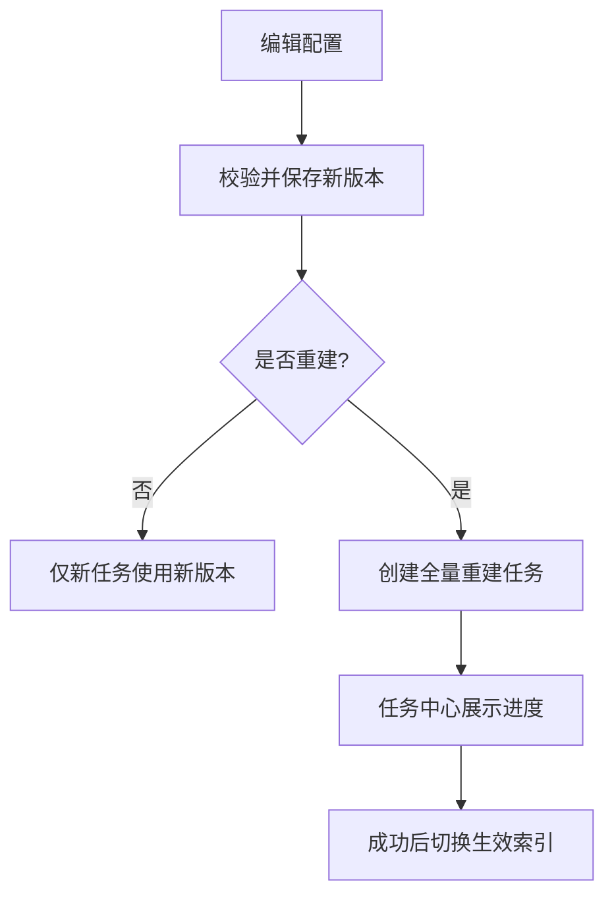
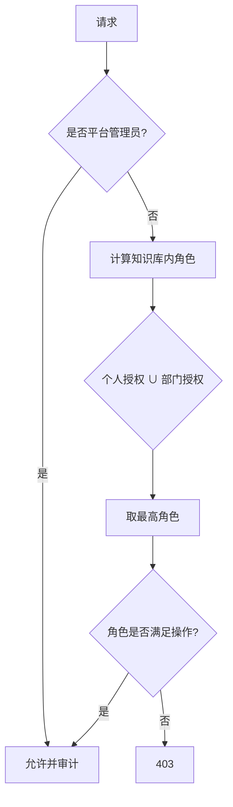

# 01 · 需求规格说明书（PRD）

> 版本：v0.1　最后更新：2026-11-07
> 上游：产品草稿《知识库智能助手》
> 下游：[页面与交互设计](02-页面与交互设计.md)、[数据模型](03-数据模型设计.md)、[接口设计](04-接口设计.md)

## 1. 背景与目标

### 1.1 背景

企业部门的知识目前以 PDF、Word、Excel、Markdown 等文件散落存放，存在四个问题：

1. **入口分散**：没有统一的知识库视图，无法按部门沉淀和复用。
2. **权限模糊**：谁可访问、谁可维护缺少明确边界，跨部门共享靠人工传文件。
3. **处理链路黑盒**：文档能否解析、切片是否合理、索引是否成功不可见，失败后只能整批重来。
4. **检索不可解释**：回答没有来源定位，无法回跳原文，难以建立信任。

### 1.2 产品目标

建设一个“配置驱动 + 任务可观测 + 检索可溯源”的知识库管理台：

- 让部门管理员在 **10 分钟内**完成一个知识库的创建、配置和首批文档入库。
- 让每一次解析、切片、索引、重建都成为 **可查看、可重试、可取消** 的任务。
- 让每一条检索结果都能 **定位到文档、页码、段落或字符区间**。

### 1.3 成功指标（一期验收后观察）

| 指标 | 目标 | 口径 |
| --- | --- | --- |
| 建库到首批可检索耗时 | ≤ 10 min（10 份、单份 ≤ 20 MB） | 从点击“创建”到首批文档状态为“已就绪” |
| 解析成功率 | ≥ 98% | 非加密、非损坏的受支持文档 |
| 任务可定位率 | 100% | 失败任务均有错误码与可读原因 |
| 越权访问 | 0 | 安全测试与线上审计 |
| 引用可回跳率 | 100% | 开启溯源时返回的引用均含有效定位信息 |

## 2. 用户与角色

### 2.1 角色

| 角色 | 说明 | 典型诉求 |
| --- | --- | --- |
| 部门知识管理员（owner/admin） | 知识库负责人，可配置全链路并授权 | 建库、调参、授权、重建、删除 |
| 知识维护者（editor） | 日常维护文档与目录 | 上传、移动、重解析、看任务 |
| 普通成员（reader） | 只读使用方 | 浏览、检索、问答 |
| 平台管理员 | 跨部门治理与审计 | 全局查看、处置异常任务、审计 |

> 角色是“知识库内”的概念。同一用户在不同知识库可拥有不同角色；部门授权按“部门 → 成员”动态展开。

### 2.2 权限矩阵

| 操作 | owner | admin | editor | reader | 平台管理员 |
| --- | :---: | :---: | :---: | :---: | :---: |
| 查看知识库、目录、文档 | ✓ | ✓ | ✓ | ✓ | ✓ |
| 检索 / 问答调用 | ✓ | ✓ | ✓ | ✓ | ✓ |
| 上传、移动、重解析、停用文档 | ✓ | ✓ | ✓ | ✗ | ✓ |
| 管理目录、标签 | ✓ | ✓ | ✓ | ✗ | ✓ |
| 修改解析/切片/检索配置 | ✓ | ✓ | ✗ | ✗ | ✓ |
| 管理成员与授权 | ✓ | ✓ | ✗ | ✗ | ✓ |
| 触发全量/增量重建 | ✓ | ✓ | ✓（仅文档级） | ✗ | ✓ |
| 编辑基础信息（名称、简介、部门） | ✓ | ✓ | ✗ | ✗ | ✓ |
| 转让 owner | ✓ | ✗ | ✗ | ✗ | ✗ |
| 删除知识库 | ✓ | ✗ | ✗ | ✗ | ✓（需二次确认） |

## 3. 范围

### 3.1 范围内

知识库列表与卡片、四步创建向导、基础信息与配置维护、成员与部门授权、目录管理、标签管理、知识（文档）管理、任务中心、检索配置与检索测试。

### 3.2 范围外（一期）

问答侧“新会话”页面、文档在线预览/编辑、知识图谱与 GraphRAG、文档版本与审批、跨库联合检索、计费与配额。

## 4. 功能需求

需求编号规则：`F<模块>-<序号>`。优先级：P0 必须、P1 应该、P2 可选。

### F1 知识库列表（P0）

**描述**：以卡片形式展示当前用户“可访问”或“可维护”的知识库，支持搜索、筛选、排序和进入详情。

**卡片字段**：主题（名称）、所属部门、简介（最多两行）、作者、更新时间、状态徽标、文档数/切片数（可选）。

**规则**

1. 顶部两个 Tab：`我的可访问`、`我的可维护`；默认 `我的可访问`。两者是同一数据源的权限视图，计数实时。
2. 列表仅返回当前用户有权限的知识库；服务端分页，默认按更新时间倒序。
3. 搜索按名称/简介模糊匹配；筛选支持部门、状态；排序支持更新时间、名称。
4. 卡片点击进入知识库详情；列表页“新建知识库”进入创建向导（无建库权限时隐藏）。
5. 空态区分“暂无知识库”和“无搜索结果”，后者提供清空筛选。
6. 加载失败展示错误与重试，不展示部分错乱数据。

**验收**

| 编号 | 场景 | 预期 |
| --- | --- | --- |
| F1-AC1 | 用户仅有 A 库 reader、B 库 editor | “可访问”含 A/B；“可维护”仅含 B |
| F1-AC2 | 无任何授权 | 两 Tab 均为空态，不出现他人知识库 |
| F1-AC3 | 搜索不存在名称 | 展示“无搜索结果”空态并可一键清空 |
| F1-AC4 | 分页切换 | 保持 Tab、搜索词、筛选条件 |

### F2 创建知识库向导（P0）

**描述**：四步向导创建知识库，逐步收敛基础信息、解析引擎、分块设置、高级设置；左侧步骤条可回退，已填内容不丢失。

**步骤与字段**

| 步骤 | 字段 | 必填 | 规则/默认 |
| --- | --- | --- | --- |
| 1 基础信息 | 名称（主题） | 是 | 2–50 字符；租户内可重名，提示但不阻断（待确认） |
| | 所属部门 | 是 | 默认当前用户主部门；决定默认授权范围 |
| | 简介 | 否 | ≤ 200 字符 |
| | 索引策略 | 是 | 默认“混合索引”；可选值见 F9 |
| 2 解析引擎 | 支持的文档类型 | 是 | 至少选 1 项：PDF / Word / Excel / Markdown |
| | 每类解析方式 | 是 | 原生文本提取 / OCR 识别 / 自动判定 |
| | OCR 语言 | 条件 | OCR 启用时必填，默认 中文+英文 |
| | 表格结构化 | 否 | 默认开启 |
| | 过滤页眉页脚/页码 | 否 | 默认开启 |
| | 提取图片内文字 | 否 | 默认关闭；开启后对文档内嵌图片走 OCR |
| 3 分块设置 | 切片策略 | 是 | 默认切分 / 按行 / 父子 / 标题增强 / 自定义 |
| | 策略参数 | 条件 | 见 F2.2 与 [05](05-解析切片与检索设计.md) |
| | 切片预览 | 否（P1） | 上传样例或使用内置样例，展示前 N 个切片 |
| 4 高级设置 | 混合检索 | 是 | 开关，默认开启 |
| | 向量/关键词权重 | 条件 | 开启混合检索时可调，默认 0.7/0.3 |
| | 精排重排序 | 是 | 开关，默认开启；可选模型 |
| | 引用溯源 | 是 | 开关，默认开启；粒度 文档/页/段落/字符区间 |
| | TopK 召回数量 | 是 | 1–100，默认 20 |
| | 精排后 TopN | 条件 | 1–20，默认 5，须 ≤ 召回 TopK |
| | 相似度阈值 | 是 | 0–1，默认 0.30；低于阈值不进入上下文 |

**交互规则**

1. “下一步”先做本步校验，失败定位到首个错误字段；跨步骤字段联动需重新校验（如关闭 OCR 后清空 OCR 语言）。
2. 支持“上一步”，已填内容保留；点击关闭/返回列表时若有未保存修改，弹出离开确认。
3. “保存草稿”（P1）：保存基础信息与配置但不激活；草稿在列表中以“草稿”状态展示，仅创建者可见。
4. 点击“创建”：服务端在同一事务内创建知识库、配置版本与 owner 成员，返回详情页；无文档时状态为“可用”。
5. 创建失败需明确回滚，不产生半初始化数据；重复提交用幂等键去重。

**验收**

| 编号 | 场景 | 预期 |
| --- | --- | --- |
| F2-AC1 | 未选文档类型点下一步 | 阻断并提示，步骤不前进 |
| F2-AC2 | 选择“按行切分”但未设最大长度 | 使用默认值或按规则校验，不允许非法参数 |
| F2-AC3 | 精排 TopN > 召回 TopK | 阻止提交并提示修正 |
| F2-AC4 | 连续点击“创建”两次 | 仅创建一个知识库（幂等） |
| F2-AC5 | 中途关闭 | 弹出离开确认；确认后不落库（或仅草稿，若启用） |

### F3 知识库信息与配置维护（P0）

**描述**：在知识库详情进入“设置”，维护基础信息与解析、切片、检索配置。

**规则**

1. 基础信息可编辑：名称、简介、所属部门、索引策略；作者与创建时间只读。
2. 修改“所属部门”需二次确认，并提示会影响部门继承成员的可见范围。
3. 修改“索引策略”属于破坏性变更：必须二次确认，并提供“仅保存 / 保存并全量重建”选择。
4. 解析/切片/检索配置保存后生成新配置版本；已运行任务继续使用旧版本快照。
5. 配置变更时提示影响范围，并提供“保存并重建存量知识”的选项；重建任务进入任务中心。
6. 页面展示“当前生效配置版本”和最近变更人/时间；版本历史为 P1。
7. 无权限用户只读展示或隐藏入口。

**验收**

| 编号 | 场景 | 预期 |
| --- | --- | --- |
| F3-AC1 | editor 打开设置页 | 配置项只读，无保存按钮 |
| F3-AC2 | 修改切片参数并选择“保存并重建” | 生成新配置版本并创建全量重建任务 |
| F3-AC3 | 修改索引策略未确认 | 不保存 |
| F3-AC4 | 重建进行中再次保存配置 | 新配置生效于后续任务，不打断在跑任务 |

### F4 成员与部门授权（P0）

**描述**：知识库维护页展示部门人员与授权成员，支持人员增删改与角色调整。

**规则**

1. 成员来源两类：`部门授权`（动态展开部门下人员）与`个人授权`；同一用户取最高角色。
2. 展示列表字段：姓名、账号、部门、角色、来源（部门/个人）、授权人、授权时间。
3. 新增成员：按姓名/账号搜索组织人员，选择角色（admin/editor/reader）；支持按部门批量授权。
4. 修改角色：不能将最后一名 owner/admin 降级；不能移除 owner。
5. 移除成员：二次确认；部门继承成员不可单独移除，需调整部门授权或添加个人排除（排除为 P2）。
6. 部门人员增删改由组织架构同步，知识库内不直接创建用户。
7. 所有授权变更写审计日志。

**验收**

| 编号 | 场景 | 预期 |
| --- | --- | --- |
| F4-AC1 | 移除唯一 owner | 阻断并提示先转让 owner |
| F4-AC2 | 用户同时有部门 reader 与个人 editor | 生效角色为 editor |
| F4-AC3 | 新增部门授权 | 该部门现有及后续成员可访问 |
| F4-AC4 | 无授权用户访问成员接口 | 403，不泄露成员列表 |

### F5 目录管理（P0）

**描述**：维护知识库内的目录树，用于组织文档；目录是分类维度，不承载权限。

**规则**

1. 支持新增、重命名、移动、删除；根目录固定为“全部知识”，不可删改。
2. 最大层级默认 5 层（可配置）；同级目录名称唯一（不区分大小写）；名称 1–50 字符。
3. 拖拽移动需校验不能移动到自身或子孙节点下；移动后文档归属随目录变更。
4. 删除目录：默认仅允许删除空目录；非空目录需选择“移动到上级”或“一并删除文档”（二次确认，输入目录名）。
5. 展示各目录文档数；目录排序支持手动排序（P1）。
6. 目录操作与文档移动写审计日志。

**验收**

| 编号 | 场景 | 预期 |
| --- | --- | --- |
| F5-AC1 | 同级新建重名目录 | 阻断并提示 |
| F5-AC2 | 将父目录拖入子目录 | 阻断 |
| F5-AC3 | 删除有文档目录 | 弹出处理方式，未选择不删除 |
| F5-AC4 | 超过最大层级 | 禁止新增并提示 |

### F6 标签管理（P0）

**描述**：以扁平标签补充目录之外的横向分类，支持标签 CRUD 与文档打标。

**规则**

1. 标签在知识库内唯一，名称 1–20 字符，可配置颜色；单库标签上限默认 200。
2. 支持新增、重命名、删除；删除标签需二次确认，仅解除关联，不删除文档。
3. 文档可设置多个标签（默认上限 10）；标签筛选支持多选（AND/OR 待确认，默认 OR）。
4. 重命名标签同步更新所有关联文档展示。
5. 标签合并为 P2。

**验收**

| 编号 | 场景 | 预期 |
| --- | --- | --- |
| F6-AC1 | 新建重名标签 | 阻断 |
| F6-AC2 | 删除标签 | 文档保留，关联解除 |
| F6-AC3 | 按两个标签筛选 | 按约定逻辑返回结果 |

### F7 知识（文档）管理（P0）

**描述**：上传、组织和维护知识库内的文档，跟踪每份文档的处理状态。

**规则**

1. 上传支持点击/拖拽、批量；格式受知识库解析配置限制；单文件默认 ≤ 100 MB，单批 ≤ 50 个（可配置）。
2. 上传时必须选择目录（默认根目录），可设置标签；上传后立即返回，解析异步执行。
3. 去重：同库内按文件内容 SHA-256 判重；命中时提示“跳过 / 覆盖（P1）”，默认跳过，不允许产生同内容的活跃文档。
4. 列表字段：文件名、类型、大小、目录、标签、状态、切片数、上传人、更新时间；支持按名称搜索及状态/目录/标签/类型筛选。
5. 状态：待处理、解析中、切片中、索引中、已就绪、失败、已停用。失败可查看错误码与原因。
6. 操作：重解析、移动目录、编辑标签、停用/启用、删除；支持批量操作。
7. 删除为软删除，异步清理切片与向量；删除中的文档不可检索。
8. 安全：服务端做真实类型识别（不信任扩展名）、病毒扫描、文件名转义；上传使用受限签名地址。
9. 文档详情展示解析配置版本、切片数、最近任务、来源信息（页数/字符数）。

**验收**

| 编号 | 场景 | 预期 |
| --- | --- | --- |
| F7-AC1 | 上传不支持的格式 | 前端拦截，服务端二次校验 |
| F7-AC2 | 超限文件 | 明确提示大小上限，不入库 |
| F7-AC3 | 重复文件 | 提示并按选择处理，不产生重复切片 |
| F7-AC4 | 解析失败 | 文档状态失败，任务中心可重试 |
| F7-AC5 | 停用文档后检索 | 不返回该文档切片 |
| F7-AC6 | 越权上传 | 403，不落存储 |

### F8 任务中心（P0）

**描述**：统一查看知识库相关异步任务，定位失败并执行重试/取消。

**规则**

1. 任务类型：上传入库、解析、切片、索引、全量/增量重建、删除清理、OCR 重跑。
2. 任务字段：任务 ID、类型、对象（文档/知识库）、状态、进度、操作人、开始/结束时间、耗时、错误码与原因、重试次数。
3. 状态：排队中、运行中、成功、失败、取消中、已取消。
4. 支持按类型、状态、时间、文档名筛选；默认倒序；运行中任务自动刷新（轮询或 SSE，P1）。
5. 失败任务支持重试（最多 3 次，指数退避）；运行中支持取消，取消后已写入的部分切片需清理，保证幂等。
6. 任务保留 30 天（可配置）；审计日志单独长期保留。
7. 同一文档同一类型任务不允许并发生成；重复触发返回已有任务 ID。

**验收**

| 编号 | 场景 | 预期 |
| --- | --- | --- |
| F8-AC1 | 重复点击重试 | 不产生并行重复任务 |
| F8-AC2 | 取消运行中任务 | 状态经“取消中”到“已取消”，无残留切片 |
| F8-AC3 | 失败任务 | 展示错误码、原因与重试入口 |
| F8-AC4 | 无任务权限 | 不能查看他人知识库任务 |

### F9 检索配置与检索测试（P0/P1）

**描述**：配置召回、精排与溯源参数，并提供受权限约束的检索测试，验证配置效果。

**配置项**

| 配置 | 类型 | 默认 | 说明 |
| --- | --- | --- | --- |
| 索引策略 | 枚举 | 混合索引 | 向量索引 / 混合索引 /（可选）图谱增强；变更需重建 |
| 混合检索 | 开关 | 开 | 开启后向量 + BM25 双路召回 |
| 向量权重 | 0–1 | 0.7 | 与关键词权重互补；也可采用 RRF（不暴露权重） |
| 精排重排序 | 开关 | 开 | 对召回候选重排 |
| 精排模型 | 枚举 | 默认模型 | 由平台提供可选列表 |
| 引用溯源 | 开关 | 开 | 返回引用定位 |
| 溯源粒度 | 枚举 | 段落 | 文档/页/段落/字符区间 |
| TopK 召回数量 | 1–100 | 20 | 召回候选数 |
| 精排后 TopN | 1–20 | 5 | 进入上下文的切片数 |
| 相似度阈值 | 0–1 | 0.30 | 低于阈值丢弃；全部丢弃时走无答案兜底 |

**检索测试（P1）**

1. 输入查询，按当前已保存配置返回命中切片、分数（召回/精排）、来源与引用定位。
2. 测试请求强制校验当前用户对知识库的读权限；不写入问答日志，或写独立测试日志（待确认）。
3. 展示耗时分解：召回、融合、精排、组装。

**验收**

| 编号 | 场景 | 预期 |
| --- | --- | --- |
| F9-AC1 | 阈值设 0.9 且无命中 | 返回空结果与兜底提示，不幻觉引用 |
| F9-AC2 | 关闭溯源 | 结果不含引用定位字段 |
| F9-AC3 | reader 调用检索测试 | 允许（只读），但仅限有权知识库 |
| F9-AC4 | 修改配置未保存即测试 | 使用已保存版本，并提示 |

## 5. 核心流程

### 5.1 建库与首批入库

### 5.2 配置变更

### 5.3 权限判定

## 6. 非功能需求

| 类别 | 要求 |
| --- | --- |
| 性能 | 列表接口 P95 ≤ 500 ms；配置保存 P95 ≤ 300 ms；检索测试 P95 ≤ 3 s（不含大模型生成）；任务状态查询 P95 ≤ 200 ms |
| 容量 | 单库文档数 ≥ 10 万；单库切片数 ≥ 500 万；单文件 ≤ 100 MB；单批 ≤ 50 个 |
| 可用性 | 管理台 99.9%；任务失败可重试；上传与任务解耦，接口不因解析阻塞 |
| 一致性 | 配置版本不可变；任务绑定配置快照；文档删除为软删除并异步清理索引 |
| 安全 | 服务端强制鉴权；文件类型嗅探 + 病毒扫描；签名 URL；审计日志；防越权与 IDOR |
| 可观测 | 全链路 traceId；任务指标（排队时长、成功率、耗时）；失败告警 |
| 兼容性 | 桌面优先，最小宽度 1280 px；Chrome/Edge 最近两个大版本 |
| 数据保留 | 任务记录 30 天；审计日志 ≥ 180 天；软删除文档 30 天后物理清理（可配置） |

## 7. 假设与约束

1. 组织架构（部门、人员）由外部系统提供，本系统只读同步。
2. 问答侧通过检索服务消费切片，不直接读管理库表。
3. 一期单租户多部门；租户隔离字段预留。
4. 索引策略、OCR、嵌入与精排模型的具体选型由平台统一提供，管理台只做配置暴露。
5. 配置变更不自动重建存量数据，需用户显式选择，避免误触发大规模任务。
6. 草稿中的“卡片点击下一步进入解析引擎”按“新建知识库向导”理解：卡片主体点击进入知识库详情，列表页“新建知识库”进入向导；卡片字段“主题”即知识库名称。
7. 草稿未明确创建时的基础信息步骤，本文按“名称 + 部门 + 简介 + 索引策略”补齐，见 Q7。

## 8. 二期候选

文档版本与回滚、标签合并、目录排序、配置版本对比与回滚、检索效果评估集、跨库检索、知识图谱增强、配额与成本看板。
