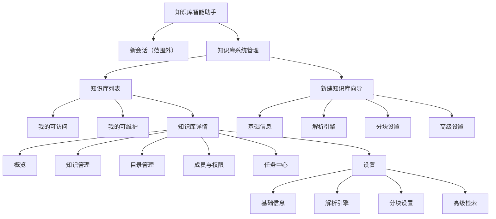

# 02 · 页面与交互设计

> 版本：v0.1　依赖：[PRD](01-需求规格说明书.md)
> 设计目标：配置路径短、状态可见、危险操作可回退。

## 1. 设计原则

1. **先分类后配置**：列表用“可访问 / 可维护”两视图承接权限差异，进入知识库后按“知识 / 目录 / 成员 / 任务 / 设置”分区。
2. **向导只收必填**：四步向导每步只暴露该步必须决策的配置，默认值可用；高级参数在设置页可再调。
3. **配置影响可见**：任何会触发重建或影响检索的变更，都在保存前说明影响范围。
4. **状态优先**：文档与任务的状态永远可见，失败必须给出原因和下一步动作。
5. **危险操作二次确认**：删除知识库/目录/文档、移除成员、切换索引策略，均需明确确认，必要时输入名称。

## 2. 信息架构



**路由建议**

| 路由 | 页面 |
| --- | --- |
| `/kb` | 知识库列表（`?tab=accessible|maintainable`） |
| `/kb/new/basic`、`/new/parse`、`/new/chunk`、`/new/advanced` | 创建向导四步（同一向导壳，路由承载步骤） |
| `/kb/:id/overview` | 概览 |
| `/kb/:id/knowledge` | 知识管理（`?dir=...&tag=...`） |
| `/kb/:id/directories` | 目录管理 |
| `/kb/:id/members` | 成员与权限 |
| `/kb/:id/tasks` | 任务中心 |
| `/kb/:id/settings/basic|parse|chunk|retrieval` | 设置 |

## 3. 全局框架

- 左侧一级导航：`新会话`（一期置灰或隐藏）、`知识库系统管理`。
- 顶部：产品名、当前部门/用户、帮助入口。
- 管理台内容区最大宽度 1440 px，桌面优先，最小 1280 px；窄屏（< 1280）卡片列数降为 2/1，表格允许横向滚动。
- 全局反馈：轻提示（成功/失败）、对话框（确认/表单）、抽屉（详情/上传），不使用连续多层弹窗。

## 4. 知识库列表页

### 4.1 布局

```text
┌──────────────────────────────────────────────────────────────────────┐
│ 知识库系统管理                                    帮助  [头像 张三]  │
│ 统一管理可访问与可维护的知识库                                      │
│                                                                      │
│ [我的可访问 12] [我的可维护 3]      [搜索名称/简介]  [+ 新建知识库] │
│ ──────────────────────────────────────────────────────────────────── │
│ 部门 [全部 ▾]   状态 [全部 ▾]   排序 [最近更新 ▾]                   │
│                                                                      │
│ ┌───────────────┐ ┌───────────────┐ ┌───────────────┐               │
│ │ [可用]      ⋯ │ │ [初始化中]  ⋯ │ │ [草稿]      ⋯ │               │
│ │ 薪酬制度问答   │ │ 考勤规则库     │ │ 入职材料库     │               │
│ │ 人力资源部     │ │ 行政部         │ │ 人力资源部     │               │
│ │ 覆盖薪酬、社保 │ │ 考勤、请假、加 │ │ 入职流程与材料 │               │
│ │ 与个税常见问题 │ │ 班规则说明     │ │               │               │
│ │ 张三 · 11-07   │ │ 李四 · 11-06   │ │ 张三 · 11-05   │               │
│ └───────────────┘ └───────────────┘ └───────────────┘               │
│                                                                      │
│                                             < 1 2 3 >  每页 12 ▾     │
└──────────────────────────────────────────────────────────────────────┘
```

### 4.2 卡片规范

| 元素 | 规则 |
| --- | --- |
| 状态徽标 | 可用（绿）、初始化中（蓝，带加载点）、部分异常（橙）、草稿（灰）、已停用（灰）、删除中（红） |
| 标题 | 最多 1 行省略，悬浮展示全称 |
| 部门 | 部门标签，最多 10 字省略 |
| 简介 | 最多 2 行，超出省略；空简介展示“暂无简介”弱文案 |
| 卡片菜单 `⋯` | 可维护用户：编辑信息、复制配置新建（P2）、停用、删除；不可维护用户不显示 |
| 主体点击 | 进入 `/kb/:id/overview`；菜单点击不触发跳转 |
| 计数 | Tab 上展示数字；筛选不改变 Tab 计数 |

### 4.3 状态与交互

| 状态 | 表现 |
| --- | --- |
| 加载中 | 卡片骨架屏 6 个，Tab 计数占位 |
| 空（无权限数据） | 插画 + “暂无可访问的知识库” + 若有建库权限则“新建知识库” |
| 空（筛选无结果） | “没有找到匹配的知识库” + “清空筛选” |
| 错误 | 错误说明 + “重试”，保留当前 Tab 与筛选 |
| 刷新 | 切换 Tab 重新请求；搜索 300 ms 防抖 |

**删除确认**：输入知识库名称后确认；提示将删除文档、切片与索引，且不可恢复。

## 5. 创建知识库向导

### 5.1 向导壳

```text
┌──────────────────────────────────────────────────────────────────────┐
│ 新建知识库                                                     [关闭]│
│ ① 基础信息 ─── ② 解析引擎 ─── ③ 分块设置 ─── ④ 高级设置            │
│                                                                      │
│  （步骤内容区）                                                      │
│                                                                      │
│  ──────────────────────────────────────────────────────────────────  │
│  [取消]                                      [上一步] [下一步]      │
└──────────────────────────────────────────────────────────────────────┘
```

- 步骤条：当前步骤高亮，已完成可点击回退；未完成步骤不可跳跃。
- 底部按钮：第 1 步隐藏“上一步”；第 4 步“下一步”变为“创建知识库”，点击后进入提交态。
- 任意关闭/取消/浏览器后退：若表单有变更，弹出“内容尚未保存，确定离开？”。
- 校验失败：滚动并聚焦首个错误字段，字段下方展示中文原因。
- 提交中：按钮 loading，禁止重复点击；成功后跳转详情并 toast“知识库创建成功”。

### 5.2 步骤 1：基础信息

| 字段 | 控件 | 校验 | 默认/提示 |
| --- | --- | --- | --- |
| 名称（主题） | 单行输入 | 必填；2–50 字符；去首尾空格 | 占位“如：薪酬制度问答” |
| 所属部门 | 部门选择器（树） | 必填 | 默认当前用户主部门 |
| 简介 | 多行输入 | ≤ 200 字符，实时计数 | 占位“说明知识库覆盖的内容与适用人群” |
| 索引策略 | 单选卡片 | 必填 | 默认“混合索引”；“图谱增强”标注“需平台开通” |

索引策略卡片说明：

- **向量索引**：语义召回，适合问答型内容。
- **混合索引**：向量 + 关键词，默认推荐。
- **图谱增强**：在混合基础上增加实体关系召回（需开通，P2）。

### 5.3 步骤 2：解析引擎

```text
支持的文件类型（至少选择 1 类）
[✓ PDF]  [✓ Word]  [✓ Excel]  [✓ Markdown]

解析方式
┌──────────┬────────┬──────────────┬────────────────────────────┐
│ 文档类型 │ 启用   │ 解析方式     │ 说明                       │
├──────────┼────────┼──────────────┼────────────────────────────┤
│ PDF      │  ✓     │ ● 自动判定   │ 有文本层直接提取，扫描页OCR│
│ Word     │  ✓     │ ○ 原生提取   │ 保留标题层级与表格         │
│ Excel    │  ✓     │ ○ 原生提取   │ 按工作表转结构化表格       │
│ Markdown │  ✓     │ ○ 原生提取   │ 按标题树保留结构           │
└──────────┴────────┴──────────────┴────────────────────────────┘

OCR 设置（当存在扫描件或选择 OCR 时展示）
语言 [中文+英文 ▾]   最低置信度 [0.60]   保留版面坐标 [✓]

解析选项
[✓] 表格结构化   [✓] 过滤页眉页脚与页码   [ ] 提取文档内图片文字
```

规则：

1. 取消勾选某类型时，该行置灰且不参与后续配置；重新勾选恢复默认解析方式。
2. Word/Excel/Markdown 的“OCR 识别”仅在开启“提取文档内图片文字”时有意义；否则禁用并提示。
3. PDF 选“自动判定”时，按页判断文本层，扫描页自动走 OCR；选“OCR 识别”则全页 OCR。
4. OCR 语言与置信度仅在 OCR 生效时校验。
5. 提示条：“解析方式影响切片质量；扫描件建议开启自动判定。”

### 5.4 步骤 3：分块设置

```text
切片策略
┌────────────┐ ┌────────────┐ ┌────────────┐ ┌────────────┐ ┌────────────┐
│ ◉ 默认切分 │ │ ○ 按行切分 │ │ ○ 父子切分 │ │ ○ 标题增强 │ │ ○ 自定义   │
│ 规则+语义  │ │ 每行一块   │ │ 父块带子块 │ │ 注入标题   │ │ 分隔符控制 │
└────────────┘ └────────────┘ └────────────┘ └────────────┘ └────────────┘

参数
最大切片长度（token） [512]     重叠长度（token） [64]
最小切片长度（token） [50]      表格整块保留 [✓]

[预览切片]      （右侧抽屉展示前 20 个切片与字数）
```

| 策略 | 参数 | 默认 |
| --- | --- | --- |
| 默认切分 | 最大长度、重叠、最小长度、表格整块、分隔符优先级（高级折叠） | 512 / 64 / 50，开 |
| 按行切分 | 最大长度、空行过滤、短行合并 | 512，开，开 |
| 父子切分 | 父块长度、子块长度、子块重叠、每父块子块上限 | 1024 / 256 / 32 / 8 |
| 标题增强 | 标题路径模板、最大长度、是否保留标题层级元数据 | `文档 > H1 > H2`，512，是 |
| 自定义 | 分隔符（支持正则）、最大长度、重叠、是否保留分隔符 | `\n\n` / 512 / 64 / 是 |

校验：

- 最大长度 64–4096；重叠 0–最大长度的 50%；最小长度 ≤ 最大长度。
- 父子切分：子块长度 < 父块长度；子块重叠 < 子块长度；父块长度 ≤ 4096。
- 自定义分隔符不能为空且必须是合法正则；保存前做一次样例切分验证。

**预览（P1）**：使用当前配置对样例文档切分，展示序号、字数、内容（可展开）、命中策略；预览不落库。

### 5.5 步骤 4：高级设置

分为三组，使用开关 + 行内参数：

| 分组 | 控件 | 默认 |
| --- | --- | --- |
| 混合检索 | 开关；开启后显示“向量权重”滑杆（0–1，关键词权重自动互补） | 开，0.7 |
| 精排重排序 | 开关；开启后选择模型、设置精排后 TopN | 开，默认模型，5 |
| 引用溯源 | 开关；开启后选择粒度（文档/页/段落/字符区间） | 开，段落 |
| 召回 | TopK 召回数量（1–100） | 20 |
| 阈值 | 相似度阈值（0–1，步长 0.01） | 0.30 |

底部“配置摘要”实时汇总：文档类型、切片策略与关键参数、检索方式、TopK/阈值，供提交前复核。

提交规则：

- 精排 TopN > 召回 TopK 时阻断。
- 关闭混合检索时隐藏权重，仅走向量召回（或按索引策略执行）。
- 创建成功后跳转 `/kb/:id/overview`，并提示“上传文档后即可开始检索”。

## 6. 知识库详情

### 6.1 详情壳

```text
┌──────────────────────────────────────────────────────────────────────┐
│ ← 薪酬制度问答  [可用]  人力资源部 · 张三 · 更新于 11-07 10:22      │
│                                               [上传知识] [设置]  ⋯  │
├──────────────────────────────────────────────────────────────────────┤
│ 概览 | 知识管理 | 目录管理 | 成员与权限 | 任务中心 | 设置            │
├──────────────────────────────────────────────────────────────────────┤
│  （Tab 内容）                                                        │
└──────────────────────────────────────────────────────────────────────┘
```

- 顶部信息随知识库数据刷新；状态“初始化中/删除中”时禁用上传与设置入口。
- 无权限的 Tab 不渲染（如 editor 无“成员与权限”）。
- `⋯`：停用知识库、删除知识库（仅 owner/平台管理员）。

### 6.2 概览

- 指标卡：文档总数、已就绪、处理中、失败任务、切片总数。
- 配置摘要：文档类型、解析方式、切片策略、检索方式、TopK/阈值；点击“去设置”。
- 最近任务：最近 5 条，含状态与耗时，点击跳任务中心。
- 快速开始：无文档时展示上传引导；有失败文档时置顶“X 份文档处理失败，去处理”。

### 6.3 知识管理

```text
┌──────────────┬───────────────────────────────────────────────────────┐
│ 目录          │ [搜索文件名] 状态[全部▾] 类型[全部▾] 标签[全部▾]      │
│ 全部知识 (128)│ [上传知识] [批量操作▾]                                │
│ ├ 制度 (40)   │ ┌───────────────────────────────────────────────────┐ │
│ │ ├ 薪酬 (12)  │ │ □ 文件名 │目录│标签│状态│切片│上传人│更新时间│⋯│ │
│ │ └ 社保 (8)   │ │ □ 薪酬管理办法.pdf ... [已就绪] 12 ...    │ │
│ ├ 流程 (30)   │ │ □ 考勤规则.docx    ... [解析中 45%] ...   │ │
│ └ 常见问题(58)│ └───────────────────────────────────────────────────┘ │
│               │                                   < 1 2 3 >          │
└──────────────┴───────────────────────────────────────────────────────┘
```

- 左侧目录树与“目录管理”共用数据，支持点击筛选；显示各目录文档数。
- 状态列展示进度（解析中/切片中/索引中）与失败原因入口；失败行可“重试”。
- 行操作：重解析、移动、编辑标签、停用/启用、删除；批量操作支持移动、打标、停用、删除。
- 上传：右侧抽屉，支持拖拽与多选，展示文件队列、格式/大小校验、目标目录、标签、去重结果；提交后关闭并可“查看任务”。
- 上传中允许关闭抽屉，任务在后台继续。

**删除确认**：单条输入文件名确认（P2 可简化为普通确认）；批量展示数量并二次确认，提示异步清理。

### 6.4 目录管理

- 左侧树 + 右侧选中节点详情（路径、文档数、创建人/时间、子目录数）。
- 工具栏：新增子目录、重命名、移动、删除；拖拽移动。
- 同级重名即时提示；移动到自身/子孙节点时禁止放置并提示。
- 删除非空目录弹窗：`移动到上级目录` / `一并删除目录及文档`；后者需输入目录名确认。
- 层级达到上限时“新增子目录”禁用并提示最大层级。

### 6.5 成员与权限

```text
[搜索姓名/账号]  [新增成员]  [按部门授权]
角色说明：owner 全部权限 · admin 管理 · editor 维护 · reader 只读

┌────────┬────────┬──────────┬────────┬──────────┬──────────┬────────┐
│ 姓名   │ 账号   │ 部门     │ 角色   │ 来源     │ 授权时间 │ 操作   │
├────────┼────────┼──────────┼────────┼──────────┼──────────┼────────┤
│ 张三   │ zhangs │ 人力资源 │ owner  │ 个人     │ 11-07    │ —      │
│ 李四   │ lisi   │ 人力资源 │ editor │ 部门继承 │ 11-07    │ 调整   │
│ 王五   │ wangw  │ 财务     │ reader │ 个人     │ 11-06    │ 移除   │
└────────┴────────┴──────────┴────────┴──────────┴──────────┴────────┘
```

- “部门继承”行不可直接移除，操作列展示“调整部门授权”跳转；tooltip 说明来源。
- 角色调整使用下拉 + 保存；降级最后一名 owner/admin 时阻止并提示。
- 新增成员弹窗：搜索组织人员（多选）、选择角色、确认；按部门授权单独弹窗。
- 变更成功后刷新列表并 toast；失败保留弹窗内容。

### 6.6 任务中心

| 列 | 说明 |
| --- | --- |
| 任务 ID / 对象 | 可点击查看任务详情抽屉 |
| 类型 | 入库、解析、切片、索引、重建、清理 |
| 状态 | 排队中/运行中/成功/失败/取消中/已取消 |
| 进度 | 运行中显示百分比进度条；失败显示错误摘要 |
| 操作人 / 时间 | 操作人、开始时间、耗时 |
| 操作 | 失败：重试；运行中：取消；成功：查看文档 |

- 筛选：类型、状态、时间范围、对象名称；默认最近 24 小时？改为默认全部并按时间倒序，提供时间快捷筛选。
- 运行中任务每 5 s 轮询（或 SSE）；页面不可见时暂停轮询。
- 详情抽屉：任务参数、配置版本、各阶段耗时、错误码/原因、重试记录。
- 取消需确认，提示“已写入的部分切片将被清理”。

### 6.7 设置

子 Tab：基础信息、解析引擎、分块设置、高级检索。复用向导的表单组件与校验。

- 顶部展示“当前配置版本 v12 · 张三 · 11-07 10:30”；有未保存修改时展示吸底保存条。
- 保存时若有影响：弹窗说明影响，提供 `仅保存` / `保存并重建`；重建默认全量，可选仅失败文档（P1）。
- 未保存切换子 Tab 时提示。
- editor 及以下只读：控件禁用，隐藏保存条。

## 7. 校验规则汇总

| 字段 | 规则 | 错误文案 |
| --- | --- | --- |
| 名称 | 必填 2–50 | 请输入 2–50 个字符的名称 |
| 简介 | ≤ 200 | 简介不能超过 200 个字符 |
| 文档类型 | 至少 1 项 | 请至少选择一种文档类型 |
| OCR 语言 | OCR 生效时必填 | 请选择 OCR 识别语言 |
| 切片最大长度 | 64–4096 | 切片长度需在 64–4096 之间 |
| 重叠长度 | 0 ≤ x ≤ 最大长度 × 50% | 重叠长度不能超过最大长度的一半 |
| 父子参数 | 子 < 父；重叠 < 子 | 子块长度需小于父块长度 |
| 自定义分隔符 | 非空且合法正则 | 分隔符格式不正确 |
| TopK | 1–100 | TopK 需在 1–100 之间 |
| 精排 TopN | 1–20 且 ≤ TopK | 精排数量不能大于召回数量 |
| 相似度阈值 | 0–1 | 阈值需在 0–1 之间 |
| 目录名 | 1–50，同级唯一 | 同级已存在同名目录 |
| 标签名 | 1–20，库内唯一 | 已存在同名标签 |
| 成员 | 至少一名 owner | 请先转让 owner |

## 8. 状态与反馈

| 场景 | 处理 |
| --- | --- |
| 列表/详情加载 | 骨架屏；超过 10 s 展示“加载较慢，请稍候” |
| 接口失败 | 各区域独立错误态 + 重试，不清空已加载内容 |
| 403 | 独立无权限页，提供“返回列表” |
| 404 | 知识库不存在或已删除，提供返回列表 |
| 保存成功 | 轻提示“已保存”，吸底条消失 |
| 删除成功 | 轻提示并返回列表/刷新树 |
| 异步提交 | 立即返回，toast“已提交，处理进度见任务中心” |
| 网络断开 | 顶部条提示，恢复后允许手动重试；不在断网时重复提交 |

## 9. 可访问性

- 所有操作可键盘完成；焦点顺序与视觉顺序一致；弹窗打开后焦点锁定，关闭后归还触发元素。
- 状态不只依赖颜色，配图标与文字；进度条提供 `aria-valuenow`。
- 表格支持表头排序提示；拖拽目录同时提供“移动到”菜单作为等价操作。
- 对比度符合 WCAG AA；错误提示与字段通过 `aria-describedby` 关联。

## 10. 文案约定

- 按钮：`新建知识库`、`下一步`、`上一步`、`创建知识库`、`保存`、`保存并重建`、`重试`、`取消任务`。
- 状态：`排队中`、`解析中`、`切片中`、`索引中`、`已就绪`、`失败`、`已停用`。
- 失败提示必须包含“发生了什么 + 可做什么”，如“文件已加密，无法解析。请移除密码后重新上传。”
- 避免术语混用：界面统一“知识库”，不出现“系列”；“切片”首次出现可带说明气泡。
