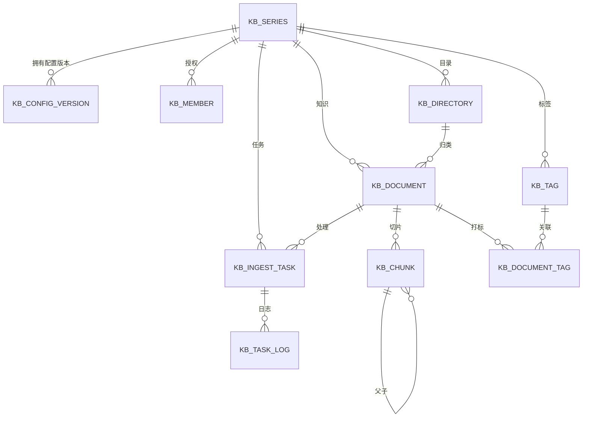
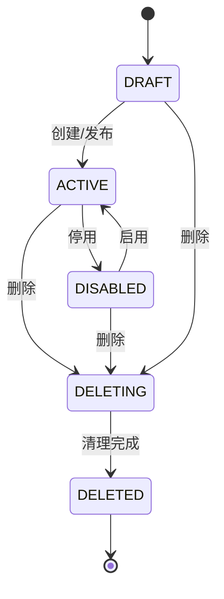
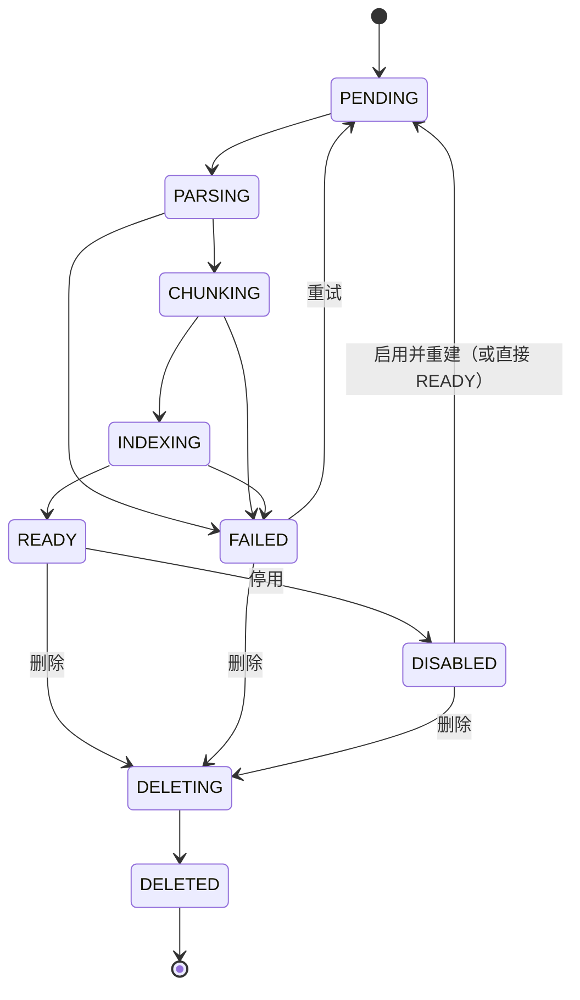
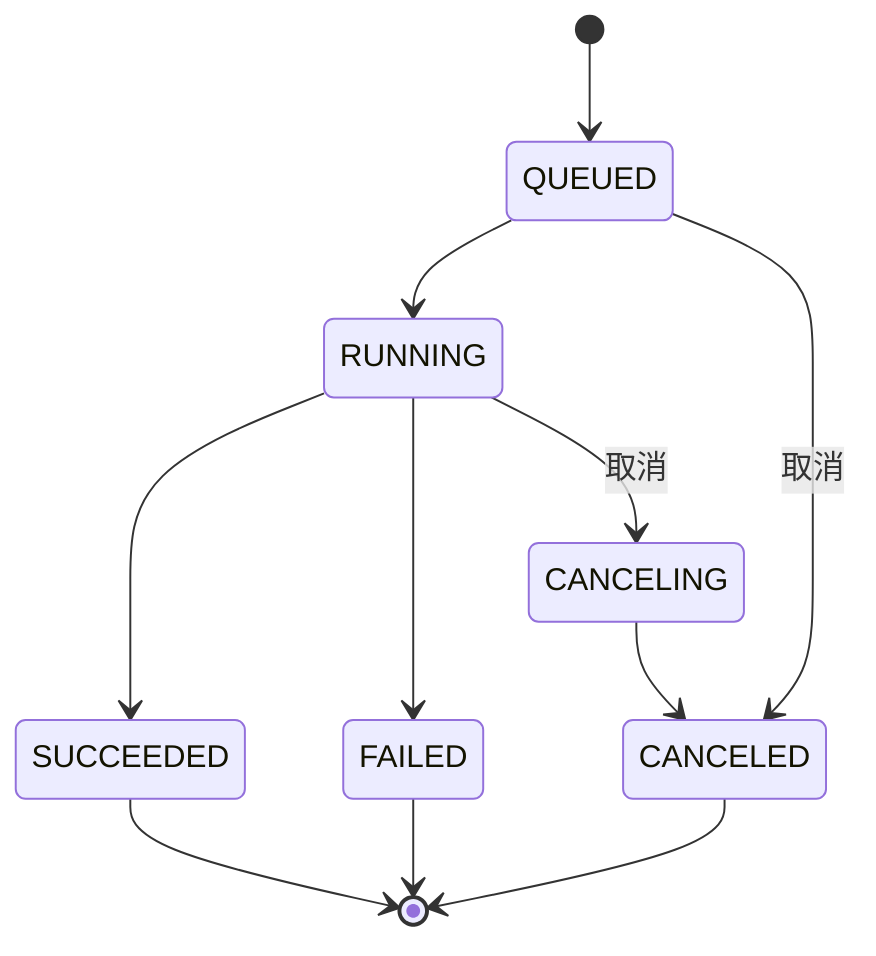

# 03 · 数据模型设计

> 版本：v0.1　数据库：MySQL 8.0（utf8mb4）
> 向量库：以 `series_id` 为逻辑命名空间，`chunk_id` 为主键；重建采用“新代索引 + 别名切换”。
> 配套：[接口设计](04-接口设计.md)、[解析切片与检索设计](05-解析切片与检索设计.md)

## 1. 领域模型



核心实体：

| 实体 | 说明 | 生命周期 |
| --- | --- | --- |
| 知识库（Series） | 配置、权限、索引的隔离单元 | 草稿 → 可用 ↔ 停用 → 删除中 → 已删除（软删） |
| 配置版本（ConfigVersion） | 解析、切片、检索配置的不可变快照 | 创建后不修改；可回滚为生效版本（P1） |
| 成员（Member） | 个人/部门授权及角色 | 可增删改，至少保留一名 owner |
| 目录（Directory） | 文档分类树，不承载权限 | 物理删除，删除前先处理文档 |
| 标签（Tag） | 横向分类 | 物理删除，仅解除关联 |
| 文档（Document） | 原始知识与处理状态 | 软删除，异步清理切片与向量 |
| 切片（Chunk） | 检索最小单元；父子结构 | 随文档重建/删除整体替换 |
| 任务（Task） | 异步处理单元 | 保留 30 天，可重试/取消 |

## 2. 表结构

> 约定：主键 `BIGINT UNSIGNED` 自增；时间统一 `DATETIME(3)`；所有表带 `tenant_id` 的实体在服务层强制租户过滤；软删除统一 `deleted_at`。

### 2.1 知识库

```sql
CREATE TABLE kb_series (
  id                       BIGINT UNSIGNED NOT NULL AUTO_INCREMENT,
  tenant_id                BIGINT UNSIGNED NOT NULL,
  name                     VARCHAR(50)     NOT NULL COMMENT '名称/主题',
  description              VARCHAR(200)    NULL,
  dept_id                  BIGINT UNSIGNED NOT NULL COMMENT '所属部门',
  author_id                BIGINT UNSIGNED NOT NULL COMMENT '创建人',
  index_strategy           VARCHAR(20)     NOT NULL DEFAULT 'HYBRID' COMMENT 'VECTOR/HYBRID/GRAPH',
  status                   VARCHAR(20)     NOT NULL DEFAULT 'DRAFT' COMMENT 'DRAFT/ACTIVE/DISABLED/DELETING/DELETED',
  active_config_version_id BIGINT UNSIGNED NULL COMMENT '当前生效配置版本',
  doc_count                INT UNSIGNED    NOT NULL DEFAULT 0,
  ready_doc_count          INT UNSIGNED    NOT NULL DEFAULT 0,
  failed_doc_count         INT UNSIGNED    NOT NULL DEFAULT 0,
  chunk_count              BIGINT UNSIGNED NOT NULL DEFAULT 0,
  row_version              INT UNSIGNED    NOT NULL DEFAULT 0 COMMENT '乐观锁',
  created_at               DATETIME(3)     NOT NULL DEFAULT CURRENT_TIMESTAMP(3),
  updated_at               DATETIME(3)     NOT NULL DEFAULT CURRENT_TIMESTAMP(3) ON UPDATE CURRENT_TIMESTAMP(3),
  deleted_at               DATETIME(3)     NULL,
  PRIMARY KEY (id),
  KEY idx_series_tenant_status (tenant_id, status, updated_at),
  KEY idx_series_dept (tenant_id, dept_id, status),
  KEY idx_series_active_config (active_config_version_id)
) ENGINE=InnoDB DEFAULT CHARSET=utf8mb4 COMMENT='知识库';
```

**状态与展示映射**

| 存储状态 | UI 展示 | 说明 |
| --- | --- | --- |
| DRAFT | 草稿 | 仅创建者可见（启用草稿能力时） |
| ACTIVE | 可用 / 初始化中 | 无已就绪文档且有运行中任务时展示“初始化中”，由接口派生，不落库 |
| ACTIVE + 存在失败文档 | 部分异常 | 由文档状态聚合，不落库 |
| DISABLED | 已停用 | 不可上传/检索，数据保留 |
| DELETING | 删除中 | 禁止所有写操作，异步清理 |
| DELETED | — | 列表不可见，软删数据按保留策略清理 |

### 2.2 配置版本（不可变）

```sql
CREATE TABLE kb_config_version (
  id              BIGINT UNSIGNED NOT NULL AUTO_INCREMENT,
  tenant_id       BIGINT UNSIGNED NOT NULL,
  series_id       BIGINT UNSIGNED NOT NULL,
  version_no      INT UNSIGNED    NOT NULL COMMENT '库内单调递增',
  index_strategy  VARCHAR(20)     NOT NULL,
  parse_config    JSON            NOT NULL,
  chunk_config    JSON            NOT NULL,
  retrieval_config JSON           NOT NULL,
  change_note     VARCHAR(200)    NULL,
  created_by      BIGINT UNSIGNED NOT NULL,
  created_at      DATETIME(3)     NOT NULL DEFAULT CURRENT_TIMESTAMP(3),
  PRIMARY KEY (id),
  UNIQUE KEY uk_config_series_version (series_id, version_no),
  KEY idx_config_series_created (series_id, created_at)
) ENGINE=InnoDB DEFAULT CHARSET=utf8mb4 COMMENT='知识库配置版本（不可变）';
```

**设计要点**

1. 一次保存 = 一个新版本；不允许 UPDATE 配置内容。
2. `kb_series.active_config_version_id` 指向“新任务默认使用的版本”；在跑任务通过 `config_version_id` 绑定旧版本，互不影响。
3. 重建成功后，索引代际切换与 `active_config_version_id` 更新需在同一编排流程中完成；失败则保留旧代索引。
4. 历史版本用于排查“某文档当时用什么配置处理”。
5. `kb_series.index_strategy` 是当前生效配置的反规范化字段（用于列表筛选），保存配置时与 `active_config_version_id` 在同一事务更新，避免展示与执行不一致。

**parse_config 示例**

```json
{
  "docTypes": ["PDF", "DOCX", "XLSX", "MD"],
  "perType": {
    "PDF":      { "enabled": true, "strategy": "AUTO" },
    "DOCX":     { "enabled": true, "strategy": "NATIVE" },
    "XLSX":     { "enabled": true, "strategy": "NATIVE" },
    "MD":       { "enabled": true, "strategy": "NATIVE" }
  },
  "ocr": {
    "languages": ["zh", "en"],
    "minConfidence": 0.60,
    "keepLayout": true
  },
  "options": {
    "tableStructure": true,
    "filterHeaderFooter": true,
    "ocrEmbeddedImages": false
  }
}
```

- `strategy`：`NATIVE` 原生文本提取、`OCR` 强制识别、`AUTO` 按页自动判定。
- 非 PDF 类型选 `OCR` 仅在 `ocrEmbeddedImages=true` 时有效，服务端需校验。

**chunk_config 示例**

```json
{
  "strategy": "PARENT_CHILD",
  "common": {
    "maxTokens": 512,
    "overlapTokens": 64,
    "minTokens": 50,
    "keepTableWhole": true,
    "tokenizer": "cl100k_base"
  },
  "byLine": {
    "maxTokens": 512,
    "dropEmpty": true,
    "mergeShortLines": true
  },
  "parentChild": {
    "parentTokens": 1024,
    "childTokens": 256,
    "childOverlap": 32,
    "maxChildrenPerParent": 8
  },
  "titleEnhanced": {
    "template": "{doc} > {h1} > {h2}",
    "keepTitlePath": true
  },
  "custom": {
    "separator": "\\n\\n",
    "keepSeparator": true
  }
}
```

仅 `strategy` 对应的参数生效，其余保留默认值，便于切换策略时保留上次填写。

**枚举约定**

| 字段 | 取值 |
| --- | --- |
| `chunk.strategy` | `DEFAULT` / `BY_LINE` / `PARENT_CHILD` / `TITLE_ENHANCED` / `CUSTOM` |
| `parse.perType.*.strategy` | `NATIVE` / `OCR` / `AUTO` |
| `retrieval.citation.granularity` | `DOCUMENT` / `PAGE` / `PARAGRAPH` / `CHAR_RANGE` |
| `retrieval.noAnswerStrategy` | `EMPTY` / `FALLBACK_TEXT` |
| `indexStrategy` | `VECTOR` / `HYBRID` / `GRAPH`（一期不开放 GRAPH） |

**retrieval_config 示例**

```json
{
  "hybridEnabled": true,
  "vectorWeight": 0.7,
  "rerankEnabled": true,
  "rerankModel": "default",
  "citation": { "enabled": true, "granularity": "PARAGRAPH" },
  "recallTopK": 20,
  "rerankTopN": 5,
  "similarityThreshold": 0.30,
  "noAnswerStrategy": "EMPTY"
}
```

`granularity`：`DOCUMENT` / `PAGE` / `PARAGRAPH` / `CHAR_RANGE`；`noAnswerStrategy`：`EMPTY`（返回空）/ `FALLBACK_TEXT`（固定兜底话术）。

### 2.3 成员与授权

```sql
CREATE TABLE kb_member (
  id            BIGINT UNSIGNED NOT NULL AUTO_INCREMENT,
  tenant_id     BIGINT UNSIGNED NOT NULL,
  series_id     BIGINT UNSIGNED NOT NULL,
  subject_type  VARCHAR(10)     NOT NULL COMMENT 'USER/DEPT',
  subject_id    BIGINT UNSIGNED NOT NULL COMMENT '用户ID或部门ID',
  role          VARCHAR(10)     NOT NULL COMMENT 'OWNER/ADMIN/EDITOR/READER',
  granted_by    BIGINT UNSIGNED NOT NULL,
  created_at    DATETIME(3)     NOT NULL DEFAULT CURRENT_TIMESTAMP(3),
  updated_at    DATETIME(3)     NOT NULL DEFAULT CURRENT_TIMESTAMP(3) ON UPDATE CURRENT_TIMESTAMP(3),
  PRIMARY KEY (id),
  UNIQUE KEY uk_member_series_subject (series_id, subject_type, subject_id),
  KEY idx_member_subject (tenant_id, subject_type, subject_id, series_id)
) ENGINE=InnoDB DEFAULT CHARSET=utf8mb4 COMMENT='知识库成员授权';
```

**有效角色计算**

1. 个人授权（`USER`）与用户所在部门的部门授权（`DEPT`）取并集。
2. 多条命中时按 `OWNER > ADMIN > EDITOR > READER` 取最高。
3. 列表页“可访问”= 有效角色 ≥ READER；“可维护”= ≥ EDITOR。
4. 组织架构变更实时影响部门授权，无需回写；部门缓存失效由组织事件驱动。

### 2.4 目录

```sql
CREATE TABLE kb_directory (
  id          BIGINT UNSIGNED NOT NULL AUTO_INCREMENT,
  tenant_id   BIGINT UNSIGNED NOT NULL,
  series_id   BIGINT UNSIGNED NOT NULL,
  parent_id   BIGINT UNSIGNED NULL COMMENT '根目录为 NULL',
  name        VARCHAR(50)     NOT NULL,
  path        VARCHAR(512)    NOT NULL COMMENT '物化路径 /1/5/9/',
  depth       TINYINT UNSIGNED NOT NULL DEFAULT 1,
  is_root     TINYINT(1)      NOT NULL DEFAULT 0,
  sort_order  INT             NOT NULL DEFAULT 0,
  doc_count   INT UNSIGNED    NOT NULL DEFAULT 0,
  created_by  BIGINT UNSIGNED NOT NULL,
  created_at  DATETIME(3)     NOT NULL DEFAULT CURRENT_TIMESTAMP(3),
  updated_at  DATETIME(3)     NOT NULL DEFAULT CURRENT_TIMESTAMP(3) ON UPDATE CURRENT_TIMESTAMP(3),
  PRIMARY KEY (id),
  UNIQUE KEY uk_dir_sibling_name (series_id, parent_id, name),
  KEY idx_dir_series_path (series_id, path),
  KEY idx_dir_series_parent (series_id, parent_id, sort_order)
) ENGINE=InnoDB DEFAULT CHARSET=utf8mb4 COMMENT='目录树';
```

约束：

- 每个知识库恰有一个 `is_root=1` 的根目录。建议增加生成列 `root_flag = IF(is_root=1, 1, NULL)` 与 `UNIQUE (series_id, root_flag)`；一期先由创建事务与服务层校验保证。
- 同一父节点下名称唯一（大小写不敏感由 `utf8mb4_0900_ai_ci` 排序规则保证）。
- `depth` 最大 5；移动子树时批量更新后代 `path/depth`。
- 目录物理删除；非空目录必须先移动或删除文档。

### 2.5 标签与文档标签

```sql
CREATE TABLE kb_tag (
  id          BIGINT UNSIGNED NOT NULL AUTO_INCREMENT,
  tenant_id   BIGINT UNSIGNED NOT NULL,
  series_id   BIGINT UNSIGNED NOT NULL,
  name        VARCHAR(20)     NOT NULL,
  color       VARCHAR(16)     NOT NULL DEFAULT '#1677ff',
  created_by  BIGINT UNSIGNED NOT NULL,
  created_at  DATETIME(3)     NOT NULL DEFAULT CURRENT_TIMESTAMP(3),
  PRIMARY KEY (id),
  UNIQUE KEY uk_tag_series_name (series_id, name)
) ENGINE=InnoDB DEFAULT CHARSET=utf8mb4 COMMENT='标签';

CREATE TABLE kb_document_tag (
  document_id BIGINT UNSIGNED NOT NULL,
  tag_id      BIGINT UNSIGNED NOT NULL,
  series_id   BIGINT UNSIGNED NOT NULL,
  created_at  DATETIME(3)     NOT NULL DEFAULT CURRENT_TIMESTAMP(3),
  PRIMARY KEY (document_id, tag_id),
  KEY idx_doc_tag_tag (series_id, tag_id, document_id)
) ENGINE=InnoDB DEFAULT CHARSET=utf8mb4 COMMENT='文档-标签关联';
```

### 2.6 文档

```sql
CREATE TABLE kb_document (
  id                BIGINT UNSIGNED NOT NULL AUTO_INCREMENT,
  tenant_id         BIGINT UNSIGNED NOT NULL,
  series_id         BIGINT UNSIGNED NOT NULL,
  directory_id      BIGINT UNSIGNED NOT NULL,
  name              VARCHAR(255)    NOT NULL COMMENT '原始文件名（已转义）',
  ext               VARCHAR(16)     NOT NULL,
  mime_type         VARCHAR(128)    NOT NULL COMMENT '服务端嗅探结果',
  size_bytes        BIGINT UNSIGNED NOT NULL,
  sha256            CHAR(64)        NOT NULL,
  deleted_at        DATETIME(3)     NULL,
  active_sha256     CHAR(64) GENERATED ALWAYS AS (IF(deleted_at IS NULL, sha256, NULL)) STORED,
  storage_key       VARCHAR(512)    NOT NULL,
  page_count        INT UNSIGNED    NULL,
  char_count        BIGINT UNSIGNED NULL,
  status            VARCHAR(20)     NOT NULL DEFAULT 'PENDING'
                    COMMENT 'PENDING/PARSING/CHUNKING/INDEXING/READY/FAILED/DISABLED/DELETING/DELETED',
  error_code        VARCHAR(64)     NULL,
  error_message     VARCHAR(500)    NULL,
  chunk_count       INT UNSIGNED    NOT NULL DEFAULT 0,
  config_version_id BIGINT UNSIGNED NULL COMMENT '最近一次处理使用的配置版本',
  row_version       INT UNSIGNED    NOT NULL DEFAULT 0,
  uploaded_by       BIGINT UNSIGNED NOT NULL,
  created_at        DATETIME(3)     NOT NULL DEFAULT CURRENT_TIMESTAMP(3),
  updated_at        DATETIME(3)     NOT NULL DEFAULT CURRENT_TIMESTAMP(3) ON UPDATE CURRENT_TIMESTAMP(3),
  deleted_at        DATETIME(3)     NULL,
  PRIMARY KEY (id),
  UNIQUE KEY uk_doc_active_hash (series_id, active_sha256),
  KEY idx_doc_series_status (series_id, status, updated_at),
  KEY idx_doc_dir (series_id, directory_id, status),
  KEY idx_doc_name (series_id, name)
) ENGINE=InnoDB DEFAULT CHARSET=utf8mb4 COMMENT='知识文档';
```

要点：

- `uk_doc_active_hash` 实现“同库内活跃文档内容唯一”，软删后同文件可重新上传（生成列变 NULL，多个 NULL 不冲突）。
- 删除文档先把 `status` 置 `DELETING` 并写 `deleted_at`，检索端按状态过滤或依赖索引墓碑；清理完成置 `DELETED`。
- 文档状态机见第 3 节；`config_version_id` 用于展示“按哪版配置处理”。

### 2.7 切片

```sql
CREATE TABLE kb_chunk (
  id              BIGINT UNSIGNED NOT NULL AUTO_INCREMENT,
  tenant_id       BIGINT UNSIGNED NOT NULL,
  series_id       BIGINT UNSIGNED NOT NULL,
  document_id     BIGINT UNSIGNED NOT NULL,
  parent_chunk_id BIGINT UNSIGNED NULL,
  chunk_level     VARCHAR(10)     NOT NULL DEFAULT 'SINGLE' COMMENT 'SINGLE/PARENT/CHILD',
  seq             INT UNSIGNED    NOT NULL COMMENT '文档内顺序',
  content         MEDIUMTEXT      NOT NULL,
  content_hash    CHAR(64)        NOT NULL COMMENT '去重与幂等',
  token_count     INT UNSIGNED    NOT NULL,
  char_start      INT UNSIGNED    NULL COMMENT '原文起始偏移',
  char_end        INT UNSIGNED    NULL COMMENT '原文结束偏移',
  page_no         INT UNSIGNED    NULL,
  bbox            JSON            NULL COMMENT '页内坐标 [x0,y0,x1,y1]',
  title_path      VARCHAR(512)    NULL COMMENT '文档 > H1 > H2',
  metadata        JSON            NULL,
  vector_id       VARCHAR(64)     NULL COMMENT '向量库主键',
  status          VARCHAR(10)     NOT NULL DEFAULT 'ACTIVE' COMMENT 'ACTIVE/STALE',
  created_at      DATETIME(3)     NOT NULL DEFAULT CURRENT_TIMESTAMP(3),
  PRIMARY KEY (id),
  KEY idx_chunk_doc_seq (document_id, seq),
  KEY idx_chunk_series_level (series_id, chunk_level, status),
  KEY idx_chunk_parent (parent_chunk_id),
  KEY idx_chunk_hash (document_id, content_hash)
) ENGINE=InnoDB DEFAULT CHARSET=utf8mb4 COMMENT='切片';
```

- `SINGLE`：普通策略；`PARENT/CHILD`：父子策略。检索只索引 `SINGLE/CHILD`，命中后可扩展到 `PARENT`。
- 重建时先写新数据（新 `seq` 批次或临时表），成功后再原子替换；旧切片置 `STALE` 并异步清理。
- `vector_id` 与向量库主键一致，便于删除与幂等写入。
- 引用溯源依赖 `page_no/char_start/char_end/bbox/title_path`；无法定位时降级到文档级。

### 2.8 任务与日志

```sql
CREATE TABLE kb_ingest_task (
  id               BIGINT UNSIGNED NOT NULL AUTO_INCREMENT,
  tenant_id        BIGINT UNSIGNED NOT NULL,
  series_id        BIGINT UNSIGNED NOT NULL,
  document_id      BIGINT UNSIGNED NULL,
  type             VARCHAR(24)     NOT NULL
                   COMMENT 'INGEST/PARSE/CHUNK/INDEX/REBUILD/FULL_REBUILD/DELETE_CLEANUP/OCR',
  status           VARCHAR(16)     NOT NULL DEFAULT 'QUEUED'
                   COMMENT 'QUEUED/RUNNING/SUCCEEDED/FAILED/CANCELING/CANCELED',
  progress         TINYINT UNSIGNED NOT NULL DEFAULT 0,
  retry_count      TINYINT UNSIGNED NOT NULL DEFAULT 0,
  retry_of_task_id BIGINT UNSIGNED NULL,
  config_version_id BIGINT UNSIGNED NULL,
  idempotency_key  VARCHAR(128)    NOT NULL,
  payload          JSON            NULL COMMENT '入参快照（文件、范围、选项）',
  error_code       VARCHAR(64)     NULL,
  error_message    VARCHAR(500)    NULL,
  operator_id      BIGINT UNSIGNED NOT NULL,
  started_at       DATETIME(3)     NULL,
  finished_at      DATETIME(3)     NULL,
  created_at       DATETIME(3)     NOT NULL DEFAULT CURRENT_TIMESTAMP(3),
  updated_at       DATETIME(3)     NOT NULL DEFAULT CURRENT_TIMESTAMP(3) ON UPDATE CURRENT_TIMESTAMP(3),
  PRIMARY KEY (id),
  UNIQUE KEY uk_task_idempotency (idempotency_key),
  KEY idx_task_series_status (series_id, status, created_at),
  KEY idx_task_doc (document_id, created_at),
  KEY idx_task_retry_of (retry_of_task_id)
) ENGINE=InnoDB DEFAULT CHARSET=utf8mb4 COMMENT='异步任务';

CREATE TABLE kb_task_log (
  id         BIGINT UNSIGNED NOT NULL AUTO_INCREMENT,
  task_id    BIGINT UNSIGNED NOT NULL,
  stage      VARCHAR(32)     NOT NULL COMMENT 'UPLOAD/PARSE/OCR/CHUNK/EMBED/INDEX/CLEANUP',
  level      VARCHAR(8)      NOT NULL DEFAULT 'INFO',
  message    VARCHAR(1000)   NULL,
  cost_ms    INT UNSIGNED    NULL,
  created_at DATETIME(3)     NOT NULL DEFAULT CURRENT_TIMESTAMP(3),
  PRIMARY KEY (id),
  KEY idx_task_log (task_id, created_at)
) ENGINE=InnoDB DEFAULT CHARSET=utf8mb4 COMMENT='任务阶段日志';
```

### 2.9 审计与事务消息

```sql
CREATE TABLE kb_audit_log (
  id          BIGINT UNSIGNED NOT NULL AUTO_INCREMENT,
  tenant_id   BIGINT UNSIGNED NOT NULL,
  series_id   BIGINT UNSIGNED NULL,
  operator_id BIGINT UNSIGNED NOT NULL,
  action      VARCHAR(48)     NOT NULL COMMENT 'SERIES_UPDATE/MEMBER_GRANT/DOC_DELETE/...',
  target_type VARCHAR(24)     NOT NULL,
  target_id   BIGINT UNSIGNED NULL,
  detail      JSON            NULL COMMENT '变更前后摘要（脱敏）',
  ip          VARCHAR(45)     NULL,
  trace_id    VARCHAR(64)     NULL,
  created_at  DATETIME(3)     NOT NULL DEFAULT CURRENT_TIMESTAMP(3),
  PRIMARY KEY (id),
  KEY idx_audit_series_time (series_id, created_at),
  KEY idx_audit_operator (tenant_id, operator_id, created_at)
) ENGINE=InnoDB DEFAULT CHARSET=utf8mb4 COMMENT='审计日志';

CREATE TABLE kb_outbox (
  id           BIGINT UNSIGNED NOT NULL AUTO_INCREMENT,
  aggregate_id BIGINT UNSIGNED NOT NULL,
  event_type   VARCHAR(48)     NOT NULL,
  payload      JSON            NOT NULL,
  status       VARCHAR(12)     NOT NULL DEFAULT 'PENDING' COMMENT 'PENDING/SENT/FAILED',
  retry_count  TINYINT UNSIGNED NOT NULL DEFAULT 0,
  created_at   DATETIME(3)     NOT NULL DEFAULT CURRENT_TIMESTAMP(3),
  sent_at      DATETIME(3)     NULL,
  PRIMARY KEY (id),
  KEY idx_outbox_status (status, created_at)
) ENGINE=InnoDB DEFAULT CHARSET=utf8mb4 COMMENT='事务消息（DB 与队列最终一致）';
```

本地事务写业务表 + outbox，投递成功后更新 `SENT`；消费端幂等。

## 3. 状态机

### 3.1 知识库



### 3.2 文档



- 状态跃迁必须由任务状态驱动，禁止前端直接改 `READY`。
- 重试生成新任务并清空上次错误；旧切片（若有）标记 `STALE`。
- 启用已停用文档：若配置与切片仍有效可直接 `READY`，否则走重建。

### 3.3 任务



重试不改原任务状态，而是新建任务并记录 `retry_of_task_id`；最多 3 次（指数退避 10s/60s/300s）。

## 4. 一致性与约束

| 编号 | 不变量 | 保障方式 |
| --- | --- | --- |
| I1 | 每库至少一名 owner | 服务层校验 + 转让流程；事务内锁 owner 集合 |
| I2 | 配置版本不可变且属于同库 | 禁止 UPDATE；任务创建时校验 `series_id` |
| I3 | 在跑任务绑定固定配置版本 | 任务创建时写入 `config_version_id`，执行器只读该版本 |
| I4 | 同库活跃文档内容唯一 | 生成列唯一索引 `uk_doc_active_hash` |
| I5 | 同文档同类型任务不并发 | 分布式锁（`series:doc:type`）+ 幂等键；任务表唯一索引兜底 |
| I6 | 切片与文档/知识库归属一致 | 写入时同事务校验；重建按文档整体替换 |
| I7 | 目录树无环、深度 ≤ 5 | 移动时校验目标不是自身/后代；路径物化 |
| I8 | 文档计数可对账 | 计数更新同事务；每日对账任务修正 |
| I9 | 删除中的文档不可检索 | 检索过滤 `deleted_at IS NULL` 且文档状态非 DELETING；索引侧墓碑 |
| I10 | 权限变更即时生效 | 每次请求计算有效角色；部门变更通过事件失效缓存 |

## 5. 索引与查询

| 场景 | 查询路径 | 索引 |
| --- | --- | --- |
| 可访问列表 | `kb_member` 按 `(tenant_id, subject_type, subject_id)` 查 series_id，再查 `kb_series` | `idx_member_subject` + 主键 |
| 可维护列表 | 同上 + `role IN (OWNER,ADMIN,EDITOR)` | `idx_member_subject` |
| 目录树 | `WHERE series_id=? ORDER BY parent_id, sort_order` | `idx_dir_series_parent` |
| 文档列表 | `series_id + directory_id + status`，按更新时间排序 | `idx_doc_dir` |
| 任务列表 | `series_id + status + created_at` | `idx_task_series_status` |
| 切片清理 | `document_id` 批量删除 | `idx_chunk_doc_seq` |

**权限过滤在服务层与 SQL 双重实现**：先解析用户可用 `series_id` 集合（含部门授权），再拼入查询；禁止仅靠前端隐藏。

## 6. 向量库映射

| 向量库字段 | 来源 | 用途 |
| --- | --- | --- |
| `id` | `kb_chunk.id` / `vector_id` | 幂等写入、删除 |
| `vector` | 嵌入模型输出 | 相似度检索 |
| `text` | `kb_chunk.content` | 返回与重排（也可只存引用） |
| `series_id` | 切片归属 | 过滤与命名空间 |
| `document_id` | 切片归属 | 删除、重建、权限 |
| `directory_id` | 文档目录 | 目录范围检索（P1） |
| `status` | ACTIVE | 过滤停用/删除 |
| `page_no/char_start/char_end` | 引用定位 | 溯源 |
| `title_path` | 结构增强 | 展示与重排特征 |
| `index_generation` | 重建批次 | 蓝绿切换 |

**重建切换**：新代索引写入完成并通过校验后，更新别名/代际指针；旧代保留 24 小时用于回滚，随后清理。

## 7. 容量与归档

- 单库文档 10 万、切片 500 万为容量基线；超出触发运营告警。
- `kb_chunk.content` 单行建议 ≤ 64 KB（MEDIUMTEXT 上限 16 MB），超长切片在解析阶段强制拆分。
- 任务记录保留 30 天，定时归档到冷表 `kb_ingest_task_archive`；审计日志保留 ≥ 180 天。
- 软删文档 30 天后清理元数据与对象存储；向量库墓碑同步清理。
