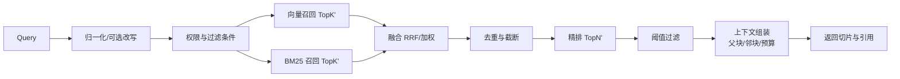

# 05 · 解析、切片与检索设计

> 版本：v0.1　范围：上传后到可检索的完整链路
> 关联：[数据模型](03-数据模型设计.md)、[接口设计](04-接口设计.md)

## 1. 总体管线


**基本原则**

1. **配置快照**：任务创建时绑定 `config_version_id`，执行过程只读该版本，运行中修改配置不影响当前任务。
2. **阶段幂等**：每个阶段以 `document_id + config_version_id + stage` 为幂等键，重试覆盖同代输出，不产生重复切片。
3. **失败隔离**：单文档失败不阻断同批其他文档；失败保留阶段与错误码，可从失败阶段重试（一期从解析阶段重跑）。
4. **可回滚**：重建写入新代索引，校验通过后切换别名；旧代保留 24 小时。

## 2. 解析引擎

### 2.1 文档类型与策略矩阵

| 类型 | 原生提取 | OCR 适用 | 默认策略 | 关键保留信息 |
| --- | --- | --- | --- | --- |
| PDF | 文本层提取（按页） | 扫描页、图片页 | 自动判定 | 页码、bbox、阅读顺序 |
| DOCX/DOC | 段落、样式、标题、表格、脚注 | 内嵌图片（可选） | 原生提取 | 标题层级、段落序号、表格结构 |
| XLSX/XLS | 工作表、单元格、公式缓存值 | 内嵌图片（可选） | 原生提取 | 工作表名、行号、表头 |
| Markdown | 标题、段落、列表、代码块、表格 | 不适用 | 原生提取 | 标题树、代码块完整性 |

**PDF 自动判定（AUTO）**

逐页判断：

- 提取文本字符数 ≥ 50，且有效字符（中英文/数字）占比 ≥ 30% → 该页走原生提取。
- 否则该页走 OCR。
- 混合文档按页合并，保留页码与坐标；同一文档内允许部分页原生、部分页 OCR。
- 整页为图片但含少量文本层（如水印）时，以有效字符占比为准，避免误判。

**策略校验**

- `NATIVE`：仅提取文本层；扫描页产出空内容时任务标记失败，错误码 `KB_42202`（建议改用 OCR）。
- `OCR`：全部页面走 OCR；适用于扫描件为主的 PDF。
- `AUTO`：推荐默认。
- DOCX/XLSX/MD 选择 `OCR` 时，仅当 `options.ocrEmbeddedImages=true` 才处理内嵌图片；否则服务端拒绝并返回配置错误。

### 2.2 OCR 设计

- **引擎抽象**：`OcrEngine` 接口，支持本地（PaddleOCR 等）与云服务；按部署形态配置，不在管理台暴露厂商细节。
- **预处理**：灰度、去噪、纠偏（倾斜角 > 1° 时）、分辨率归一（200–300 DPI）；避免过度锐化影响小字。
- **版面分析**：按块识别段落、表格、标题；阅读顺序按“从上到下、从左到右”，双栏按栏处理。
- **语言**：默认 `zh + en`；中英混排不切换模型，按行识别。
- **置信度**：整页平均置信度 < `minConfidence`（默认 0.60）时，若存在原生文本层则回退原生；否则仍产出内容，但在文档详情标记“低置信度”，任务成功并记录警告。
- **坐标**：保留行级 bbox，用于引用高亮；表格保留单元格坐标（P2）。
- **性能**：OCR 按页并行（并发度可配），单页超时 30 s；超时页重试 1 次后标记该页失败，整篇任务失败并给出页码。

### 2.3 归一化

| 处理 | 规则 | 目的 |
| --- | --- | --- |
| 字符归一 | NFKC、全角转半角（保留中文标点）、去除零宽字符 | 提升检索一致性 |
| 空白 | 合并连续空格/换行；段间保留一个空行 | 切片边界稳定 |
| 页眉页脚 | 连续页面顶部/底部相似文本（相似度 ≥ 0.9）且长度 ≤ 50 → 判定为页眉页脚并移除 | 去噪 |
| 页码 | 纯数字/“第 X 页”等模式且位于页边 → 移除 | 去噪 |
| 连字符 | 行尾连字符 + 下一行小写开头 → 合并单词 | 英文断词修复 |
| 阅读顺序 | PDF 按栏、DOCX 按文档流、OCR 按版面块排序 | 语义连续 |
| 表格 | 统一转 Markdown 表格；复杂合并单元格展开为网格 | 可检索、可切片 |
| 标题推断 | DOCX/MD 用样式/语法；PDF 用字号、加粗、编号模式；OCR 用版面 | 标题增强切片 |
| 代码块 | MD 代码块整体保留，不参与段落切分 | 完整性 |
| 来源映射 | 归一化文本按段保存 `original_offset/page/bbox` | 引用溯源 |

**来源映射结构**

```json
{
  "segments": [
    { "normStart": 0, "normEnd": 120, "pageNo": 1, "charStart": 0, "charEnd": 118, "bbox": [72, 96, 523, 210] },
    { "normStart": 121, "normEnd": 260, "pageNo": 1, "charStart": 140, "charEnd": 279, "bbox": [72, 220, 523, 330] }
  ]
}
```

切片时按 `normStart/normEnd` 反查原始定位，写入 `kb_chunk.page_no/char_start/char_end/bbox/title_path`。

### 2.4 解析失败分类

| 错误码 | 场景 | 用户提示 | 可重试 |
| --- | --- | --- | --- |
| `KB_42201` | 文档加密/损坏 | 请移除密码或修复文件后重新上传 | 否（需换文件） |
| `KB_42202` | 无有效文本（扫描件未开 OCR） | 该文档为扫描件，请在解析设置中启用 OCR | 是（改配置） |
| `KB_42203` | OCR 超时/服务不可用 | 识别服务暂不可用，请稍后重试 | 是 |
| `KB_42204` | 文档为空或无可提取内容 | 文档没有可索引内容 | 否 |
| `KB_42205` | 文件过大/页数超限 | 超出单文档处理上限，请拆分 | 否 |
| `KB_42206` | 格式与扩展名不符 | 文件真实格式不受支持 | 否 |
| `KB_42207` | 安全扫描未通过 | 文件未通过安全检查 | 否 |

## 3. 切片设计

### 3.1 通用规则

- **计量单位**：token，使用与嵌入模型一致的 tokenizer（配置 `tokenizer`）；无法加载时按“中文 1 字 ≈ 1 token、英文 4 字符 ≈ 1 token”估算，并在任务日志标注估算。
- **边界优先级**：段落 > 换行 > 中文句号/问号/感叹号 > 分号 > 逗号 > 空格。不得在数字、单位、URL 中间切断。
- **长度**：`maxTokens` 64–4096；`overlapTokens` ≤ max/2；`minTokens` 默认 50，低于最小长度的尾块并入前块。
- **表格**：默认整表一块；超过 `maxTokens × 1.5` 时按行拆分，每块重复表头。
- **代码块**：整块保留；超长代码按函数/空行拆分，保留语言标注。
- **标题**：孤立标题不单独成块，与其后正文合并。
- **去重**：同文档内 `content_hash` 相同的切片仅保留首个。
- **稳定标识**：`vector_id = "{documentId}:{configVersionId}:{seq}:{contentHash前8位}"`，保证重试幂等。

### 3.2 默认切分（DEFAULT）

适用：通用制度、说明文档、混合内容。

参数：

| 参数 | 默认 | 范围 |
| --- | --- | --- |
| `maxTokens` | 512 | 64–4096 |
| `overlapTokens` | 64 | 0–max/2 |
| `minTokens` | 50 | 0–max |
| `keepTableWhole` | true | — |
| `separatorPriority`（高级） | `["\n\n","\n","。","；","，"," "]` | 可调顺序 |

算法：

1. 若全文 ≤ max，直接成块。
2. 按分隔符优先级递归：优先在最高级分隔符处切分；若某段仍超长，降级到下一分隔符。
3. 自左向右累积片段，直到加入下一片段会超 max，则封块。
4. 相邻块尾部追加 overlap tokens（优先在句子边界对齐，避免截断）。
5. 小于 min 的尾块并入前块；仍不足则单独成块但标记 `short=true`。
6. 表格与代码块按 3.1 特殊处理。

### 3.3 按行切分（BY_LINE）

适用：问答清单、日志、逐条规则、Excel 行。

参数：`maxTokens`（默认 512）、`dropEmpty`（默认 true）、`mergeShortLines`（默认 true）。

规则：

- 每个非空行一块；行超长时按默认切分二次拆分。
- `mergeShortLines=true` 时，连续短行（合计 ≤ max/2）合并为一块，避免大量碎片。
- Excel 场景优先按“表头 + N 行”成块，而不是逐行独立，避免丢失列语义（见 3.7）。

风险：单行过短导致召回噪声高；默认开启短行合并。

### 3.4 父子切分（PARENT_CHILD）

适用：长文档、需要上下文完整性的问答。

参数：

| 参数 | 默认 | 约束 |
| --- | --- | --- |
| `parentTokens` | 1024 | 256–4096 |
| `childTokens` | 256 | 64–parentTokens |
| `childOverlap` | 32 | 0–childTokens/2 |
| `maxChildrenPerParent` | 8 | 1–32 |

流程：

1. 用默认切分按 `parentTokens` 生成父块，保留完整语义段落。
2. 每个父块内按 `childTokens` 生成子块，子块带重叠。
3. 子块 `chunk_level=CHILD`，`parent_chunk_id` 指向父块；父块 `chunk_level=PARENT`。
4. 仅子块写入检索索引；命中子块后按 `parent_chunk_id` 取父块作为上下文。
5. 父块超过 `maxChildrenPerParent` 时，按语义边界追加父块，不强行截断子块。
6. 父块内容用于上下文组装，不参与相似度计算；引用定位取子块（更精确），展示时可附父块范围。

上下文扩展预算：父块超过上下文预算时，优先返回子块及其前后各一个子块，避免单条结果挤占全部预算。

### 3.5 文档标题增强切分（TITLE_ENHANCED）

适用：手册、规范、层级清晰的文档。

参数：`template`（默认 `{doc} > {h1} > {h2}`）、`maxTokens`、`keepTitlePath`。

流程：

1. 构建标题栈：文档标题 → H1 → H2 → H3；遇到新标题时出栈。
2. 按标题小节边界切分，小节内再按默认切分。
3. 每个切片前置标题路径（按模板），并写入 `title_path` 元数据。
4. 标题前缀计入 token 预算：若前缀超过 max 的 25%，逐级截断路径（保留最近两级）。
5. 标题下无正文的，与下一节合并；连续短小节合并至不超过 max。

示例：

```text
[薪酬管理办法 > 第三章 假期 > 年假]
员工累计工作满 1 年不满 10 年的，年休假 5 天；满 10 年不满 20 年的，年休假 10 天……
```

### 3.6 自定义切分（CUSTOM）

适用：有稳定分隔符的结构化文本（如 `---`、`###`、自定义标记）。

参数：

| 参数 | 默认 | 约束 |
| --- | --- | --- |
| `separator` | `\n\n` | 非空合法正则，长度 ≤ 200，禁止灾难性回溯 |
| `maxTokens` | 512 | 64–4096 |
| `overlapTokens` | 64 | 0–max/2 |
| `keepSeparator` | true | — |

规则：

- 按正则切分；若某段超长，回退到默认切分。
- `keepSeparator=true` 时分隔符保留在块尾（或块首，按分隔符是否语义化决定，默认块尾）。
- 保存前用样例文本执行一次切分，校验不超时（100 ms）且至少产生 1 块。
- 正则包含命名分组时不使用；对用户输入做转义提示。

### 3.7 结构化类型特殊规则

| 类型 | 规则 |
| --- | --- |
| Excel | 每个工作表视为一节；识别表头行（首行或加粗行）；按 N 行（默认 20）成块，每块重复表头；合并单元格展开；公式取缓存值；隐藏工作表默认跳过（可配） |
| 表格 | 转 Markdown；行数过多按行拆，表头重复；单元格超长截断至 500 字符并保留原文定位 |
| Markdown | 按标题树切分；代码块、引用块、列表保持完整；Front Matter 作为元数据，不参与正文 |
| PDF 双栏 | 先按栏排序再切分；跨栏段落以版面块判断，避免左右串行 |
| 扫描件 | OCR 行合并为段落后切分；低置信度行不单独成块，附在相邻块 |

### 3.8 切片质量校验

发布前对样例文档做自动检查：

- 块大小分布：P50 在 [0.6×max, max]，P99 ≤ 1.2×max。
- 超短块占比（< minTokens）≤ 10%。
- 重复块占比 ≤ 1%。
- 标题块不得为孤立标题。
- 表格块不得丢失表头。
- 代码块闭合完整。

不达标时在预览中提示，但不强制阻止保存（用户可能确有特殊需求）。

## 4. 嵌入与索引

### 4.1 嵌入

- 批量大小按模型限制（默认 32）；失败按指数退避重试 3 次，仍失败则任务失败并保留已完成批次（重试幂等覆盖）。
- 输入文本 = `title_path + "\n" + content`（可配置是否拼接标题）；拼接内容同时写入向量，避免语义偏离。
- 文本截断至模型上限，超长切片在切片阶段已受限，正常不会触发。
- 内容哈希缓存：`hash(model + text)` 命中则复用向量，降低重建成本。
- 向量归一化后写入，相似度使用余弦（等价内积）。

### 4.2 关键词索引（BM25）

- 字段：`content`、`title_path`、`document_name`；权重 `content:1.0, title_path:1.5, document_name:1.2`。
- 中文分词：词典 + 智能切分；英文小写、去停用词；保留数字、单位与专有名词。
- 过滤字段：`series_id`、`document_id`、`directory_id`、`status`。
- 与向量索引同一代际写入，避免检索时新旧混用。

### 4.3 向量索引参数（基线）

| 参数 | 基线 | 说明 |
| --- | --- | --- |
| 索引类型 | HNSW | 低延迟、支持增量 |
| `M` | 16 | 图连接数 |
| `efConstruction` | 200 | 构建精度 |
| `efSearch` | 64 | 查询精度，可按延迟调整 |
| 距离 | Cosine | 向量已归一化 |
| 命名空间 | `series_id + generation` | 隔离与重建 |

### 4.4 数据一致性

1. 切片写入 MySQL（`kb_chunk`）成功后再写索引；索引写入失败可重试，状态由任务驱动。
2. 使用 outbox/任务日志保证“库有、索引无”可补偿；每日对账抽样校验数量与抽样内容。
3. 删除文档：先标记 `DELETING`，写索引墓碑（或按 `status` 过滤），再异步物理删除；检索端双重过滤。
4. 重建：写入 `index_generation=N+1`，完成后切换别名；旧代保留 24 小时，可回滚。

## 5. 检索设计

### 5.1 检索管线



### 5.2 召回

- 向量召回：`TopK_recall = max(recallTopK × 3, 50)`，为精排留候选；最终对外仍按 `recallTopK` 统计。
- BM25 召回：同量级候选；过滤条件与向量召回一致。
- 过滤：`series_id`、`status=ACTIVE`、`deleted_at IS NULL`、文档非 `DELETING/DISABLED`；目录范围（P1）。
- 权限：系列级读权限在服务层校验；候选结果再做一次文档可见性校验，防止索引脏数据越权。

### 5.3 融合

**默认加权融合**（与配置一致）：

```text
vec_norm = min-max 归一化(cosine) 或 sigmoid
bm25_norm = min-max 归一化(bm25)
score = w_v × vec_norm + (1 - w_v) × bm25_norm
```

- `w_v` 默认 0.7；权重仅在开启混合检索时生效。
- 关闭混合检索时仅走向量召回，`score = vec_norm`。
- 备选 **RRF**：`score = Σ 1/(k + rank_i)`，`k=60`；对分数尺度不敏感，适合召回源差异大时。是否对用户暴露为“融合方式”待确认（见 06）。

### 5.4 精排

- 候选：融合后前 `max(50, rerankTopN × 5)` 条，截断至模型最大输入长度。
- 输入：`(query, title_path + content)`；批量推理，超时 500 ms。
- 失败降级：精排服务异常时回退融合分数，任务不失败，检索结果标记 `degraded=true`（日志与指标可见）。
- 分数：模型原始分数经 sigmoid 归一到 0–1，用于阈值过滤。

### 5.5 阈值与无答案

- 阈值作用于最终分数（有精排用精排分，否则用融合分）。
- 全部低于阈值 → 返回空结果；`noAnswerStrategy=FALLBACK_TEXT` 时返回固定话术，不附带引用。
- 阈值需按模型校准；默认 0.30 仅作起点。不同模型/语言应提供推荐值（P1）。

### 5.6 上下文组装

1. 去重：相同 `content_hash` 或高度重叠（> 80%）的切片只保留分数最高者。
2. 父子扩展：命中子块时取父块；父块与其他命中重叠时合并。
3. 邻块扩展：同一文档相邻 `seq ± 1`，仅在预算允许且分数接近时加入。
4. 排序：按精排分数降序；同文档结果相邻排列，提升可读性。
5. 预算：总 token 上限默认 6000（可配）；超预算时先丢低分切片，再截断父块，最后压缩邻块。
6. 引用编号：按最终上下文顺序分配 `[1..n]`，返回切片与定位；生成侧只能引用给定编号。

### 5.7 引用溯源

| 粒度 | 返回定位 | 适用 |
| --- | --- | --- |
| DOCUMENT | 文档 ID/名称 | 最低成本 |
| PAGE | 页码 + bbox | PDF/扫描件 |
| PARAGRAPH | 段落序号 + 字符区间 | DOCX/MD |
| CHAR_RANGE | 字符起止 + 页码 | 精确高亮 |

- 引用对象必须含：`documentId`、`documentName`、`chunkId`、`titlePath`、`locator`。
- PDF：`pageNo + bbox`；DOCX：`paragraphIndex + charStart/charEnd`；XLSX：`sheetName + rowRange`；MD：`headingPath + charRange`。
- 无法定位时降级到文档级，并标记 `precision=LOW`。
- 前端渲染引用时对文档名、标题、内容做转义，防止文档内容注入 XSS。
- 引用只允许指向本次上下文中实际提供的切片；生成侧越界引用应被过滤。

### 5.8 降级策略

| 故障 | 降级 |
| --- | --- |
| 嵌入服务不可用 | 检索走 BM25；入库任务排队重试，不丢数据 |
| 向量库超时 | 返回 BM25 结果并标记降级；全部超时则返回错误 |
| 精排不可用 | 使用融合分数 |
| 父块缺失 | 返回子块，引用仍可用 |
| 全部无结果 | 空结果或固定兜底话术，不伪造引用 |

### 5.9 性能目标

| 阶段 | P95 目标 |
| --- | --- |
| 查询归一化 + 权限过滤 | ≤ 20 ms |
| 双路召回 | ≤ 200 ms |
| 融合去重 | ≤ 20 ms |
| 精排 | ≤ 300 ms |
| 上下文组装 | ≤ 50 ms |
| 检索总计（不含生成） | ≤ 600 ms；检索测试接口 ≤ 3 s |

## 6. 配置变更与重建

| 变更 | 是否重建 | 范围 |
| --- | --- | --- |
| 文档类型、解析方式、OCR 选项 | 是 | 受影响类型文档或全量 |
| 切片策略或参数 | 是 | 全量 |
| 嵌入模型/维度 | 是 | 全量，需新索引代际 |
| 索引策略（向量 ↔ 混合 ↔ 图谱） | 是 | 全量 |
| 仅检索参数（TopK/阈值/权重/精排开关） | 否 | 立即生效 |
| 引用开关/粒度 | 否 | 立即生效（历史切片已存定位） |

重建编排：

1. 固化配置版本和文档清单（分页快照），创建 `FULL_REBUILD` 任务。
2. 按文档拆分 `INGEST` 子任务，限制并发（默认 4），失败不阻断其他文档。
3. 写入新代索引；全部成功后切换别名，更新 `active_config_version_id` 与文档统计。
4. 记录失败文档清单，任务状态为“部分成功”时前端展示可重试入口（任务状态仍为 FAILED，附 `failedItems`）。
5. 旧代索引保留 24 小时；回滚通过切回旧别名完成（P1 提供按钮）。

## 7. 质量评估

### 7.1 离线评估

- 每个知识库维护一组黄金问答（问题 + 期望文档/片段，P1 提供管理入口）。
- 指标：Recall@5、MRR、nDCG@10、引用准确率、无答案准确率。
- 切片评估：块大小分布、超短块比例、重复率、边界完整性（人工抽检 20 条）。

### 7.2 调参建议

| 场景 | 建议 |
| --- | --- |
| 短问答/FAQ | 默认切分，256–512 token，overlap 32–64 |
| 长制度/手册 | 父子切分，父 1024 / 子 256；或标题增强 |
| 表格/清单 | 按行 + 表头重复；避免父子 |
| 扫描件 | 自动判定 + OCR；保留 bbox 便于溯源 |
| 召回不足 | 提高 TopK、降低阈值、检查切片是否过短 |
| 噪声多 | 提高阈值、开启精排、开启标题增强 |

### 7.3 线上指标

检索耗时、召回数量、阈值过滤率、无答案率、引用点击率、重建成功率、解析失败 Top 原因。

## 8. 安全与合规

- 文件上传：真实类型嗅探、病毒扫描、文件名转义、对象存储私有桶 + 短时签名 URL。
- 内容安全：文档内容视为不可信数据；生成侧用分隔符包裹，禁止执行文档中的指令；引用渲染转义。
- 权限：检索与下载均校验知识库读权限；向量库过滤条件不可省略。
- 日志：不记录完整文档内容与查询原文（可脱敏/哈希）；错误日志保留 traceId。
- 多租户：所有查询强制 `tenant_id`；向量命名空间含租户与知识库标识。
- 数据清理：删除文档 30 天内可恢复（P1）；到期物理删除对象、切片、向量与缓存。

## 9. 已知风险

| 风险 | 影响 | 缓解 |
| --- | --- | --- |
| 扫描件 OCR 质量不稳定 | 切片噪声、召回差 | 置信度门槛、低置信标记、人工抽检、可切换引擎 |
| 表格结构复杂 | 语义丢失 | 转 Markdown 网格、保留原页引用、必要时整表不切 |
| 配置参数过多 | 用户不会调 | 默认值 + 预设模板（FAQ/手册/表格）P1 |
| 重建耗时长 | 影响使用 | 增量/失败重试、并发控制、代际切换不中断查询 |
| 阈值与模型强相关 | 默认阈值不准 | 提供推荐值、检索测试、校准工具 |
| 文档内容注入 | 生成侧被误导 | 内容隔离、指令过滤、引用约束 |
